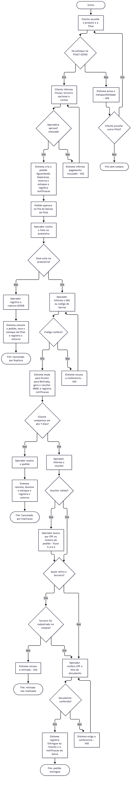
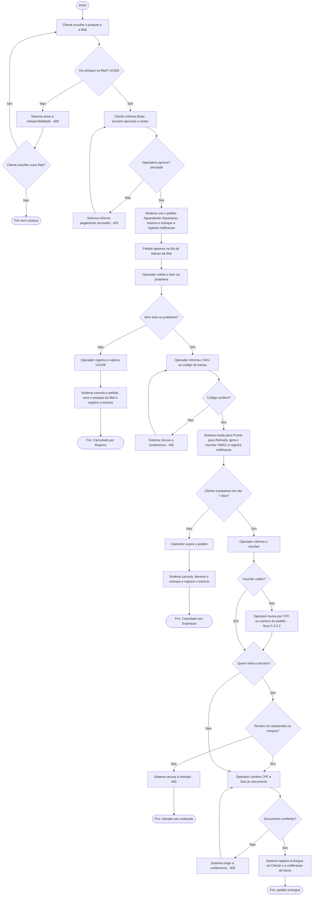

# Diagrama de atividades (S2-03)

> Gerado a partir do código da `main` em 12/11/2026 (backend NestJS + Supabase). É a versão em Mermaid, que o GitHub desenha sozinho; a imagem está em `atividades.png`. O cartão pede também o arquivo `.drawio`: para isso, no Draw.io use Organizar > Inserir > Avançado > Mermaid e cole o bloco abaixo. Falta a revisão da Júlia e do João.

Fluxo principal compra, separação e retirada, com os desvios: sem estoque, pagamento recusado, SKU errado, ruptura, expiração, voucher não localizado e retirada por terceiro.

## Notas

- Os códigos HTTP entre parênteses são os que a API devolve em cada desvio; todos estão cobertos pelos testes de contrato (`tests/contract/`, PR #8).
- A expiração por abandono **não é automática**: o operador aciona o botão no painel e a API cancela e devolve o estoque.
- O pagamento e o estoque são simulados, como no diagrama de classes.
