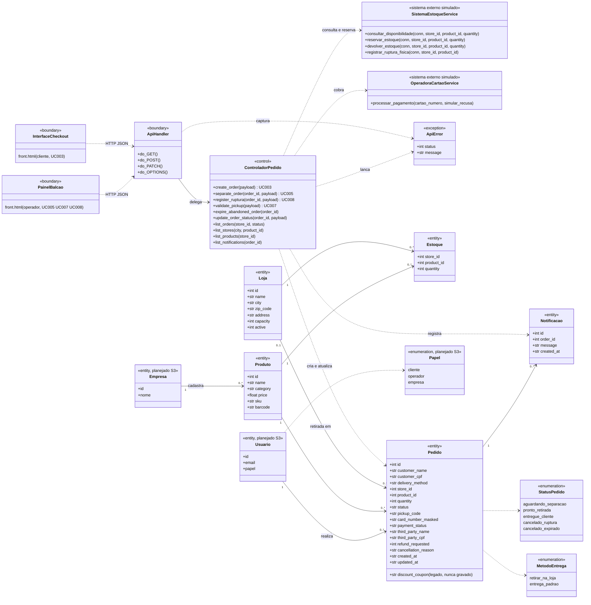

# Rascunho do diagrama de classes (S2-02)

Rascunho gerado a partir do código em 04/11/2026 (`backend/services.py`, `backend/database.py`, `backend/api.py`, `backend/config.py`).
**É um ponto de partida para a Júlia revisar e redesenhar no Draw.io**, não a versão final do S2-02.
Os nomes de atributos são os reais (colunas do banco). Os nomes de classe em português seguem o diagrama de sequência da Sprint 1.

## Diagrama (Mermaid)

Para ver: colar em <https://mermaid.live>, ou no Draw.io usar Organizar > Inserir > Avançado > Mermaid (se o menu for outro, exportar o SVG/PNG do mermaid.live e importar).

## O que bate e o que não bate com o código

| # | Observação | Decisão sugerida |
|---|---|---|
| 1 | `ControladorPedido` **não existe como classe**. O papel de controle é feito por funções de módulo em `services.py`. O nome só aparece em docstrings e no README | Manter no diagrama como controle conceitual, com nota "realizado por funções de services.py". Refatorar para classe só se o PO quiser |
| 2 | `InterfaceCheckout` e `PainelBalcao` são **conceituais**: ambos vivem em `front.html`, sem classes JavaScript com esses nomes | Manter como fronteiras lógicas |
| 3 | Só 4 classes reais: `ApiHandler`, `ApiError`, `OperadoraCartaoService`, `SistemaEstoqueService` (esta e a de cartão só com métodos estáticos) | Documentado acima |
| 4 | `Estoque` é tabela de associação Loja x Produto com `quantity` (chave composta) | Pode virar classe de associação no Draw.io |
| 5 | `Pedido` guarda **um produto e uma quantidade** (`product_id`, `quantity`). Não há item de pedido nem carrinho no backend | Limitação do modelo, registrar no documento |
| 6 | `discount_coupon` é resíduo do cupom removido no commit `4db6e39`: está na tabela e nas consultas, mas nenhum código grava nele | Marcar como legado no diagrama e remover do esquema numa limpeza (ideal antes de migrar para o Supabase, S3-06) |
| 7 | `StatusPedido`: `config.py` também aceita aliases legados (`aguardando_preparacao`, `retirado`, `cancelado`) | Diagrama mostra só os 5 oficiais |
| 8 | Sistema de Estoque e Operadora de Cartão são **simulados** (SQLite local e regra "cartão terminado em 0000 recusa") | Nota no diagrama: atores externos previstos, não integrados |
| 9 | Relacionamentos Pedido→Produto e Pedido→Loja existem como chave estrangeira. `store_id` é opcional (entrega padrão) | Cardinalidade `0..1` já marcada |
| 10 | Usuário, Empresa e Papel **não existem no código**. Entraram só porque o S3-07 e o S3-08 os exigem | Desenhar tracejado ou em cinza e legendar "planejado, Sprint 3" |

## Antes de entregar (checklist do S2-02)

- [ ] Júlia confere atributos e métodos contra o código (este rascunho é de 04/11; se o S2-06, S2-08 ou o S2-12 mudarem o backend, atualizar)
- [ ] Redesenhar no Draw.io e salvar `.drawio` e `.png` nesta pasta
- [ ] João revisa
