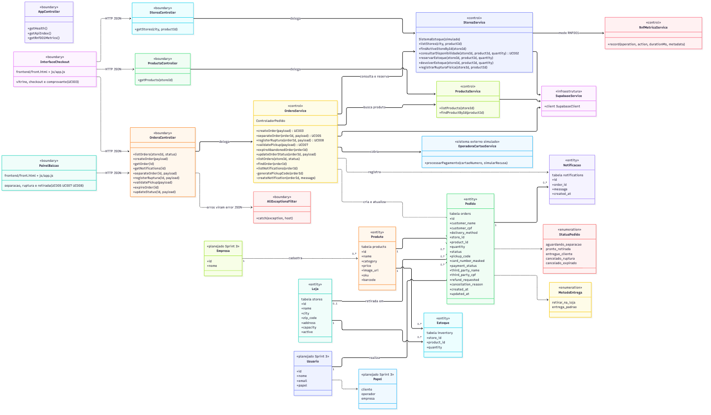
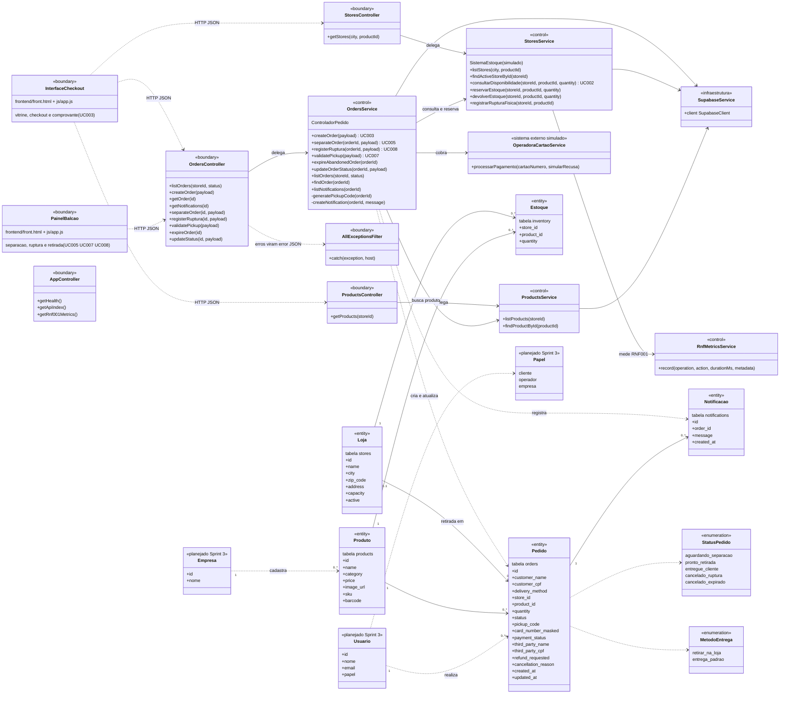

# Diagrama de classes (S2-02)

> Gerado a partir do código da `main` em 12/11/2026 (backend NestJS + Supabase). É a versão em Mermaid, que o GitHub desenha sozinho; a imagem está em `classes.png`. O cartão pede também o arquivo `.drawio`: para isso, no Draw.io use Organizar > Inserir > Avançado > Mermaid e cole o bloco abaixo. Falta a revisão da Júlia e do João.

## Como ler

- **Fronteira (boundary):** as telas do front (`InterfaceCheckout`, `PainelBalcao`) e os controladores HTTP do NestJS.
- **Controle (control):** os serviços. `OrdersService` é o `ControladorPedido` dos diagramas de sequência.
- **Entidade (entity):** as tabelas do Supabase. Não existem classes de entidade no código; os nomes em português são os do modelo e o nome da tabela está em cada caixa.
- **Planejado Sprint 3:** `Usuario`, `Empresa` e `Papel` ainda não existem no código (S3-07 e S3-08).

## O que bate e o que não bate com o código

| # | Observação |
|---|---|
| 1 | `ControladorPedido` agora **é uma classe**: `OrdersService` (`backend/src/orders/orders.service.ts`). No rascunho de 04/11, em Python, era só um conjunto de funções. |
| 2 | `InterfaceCheckout` e `PainelBalcao` são fronteiras lógicas: as duas vivem em `frontend/front.html` e `frontend/js/app.js`, sem classes com esses nomes. |
| 3 | Sistema de Estoque e Operadora de Cartão são **simulados**: o estoque é a tabela `inventory` do próprio banco e o cartão é recusado por regra local (final 0000 ou opção de teste). |
| 4 | `Pedido` guarda **um produto e uma quantidade**. Não há item de pedido nem carrinho. |
| 5 | `Estoque` é a associação Loja x Produto com `quantity` (chave composta). |
| 6 | `StatusPedido` mostra os 5 estados oficiais; o código ainda aceita 3 apelidos antigos (`aguardando_preparacao`, `retirado`, `cancelado`). |
| 7 | `discount_coupon` saiu do diagrama: a coluna não existe no banco e está sendo removida do código no PR #7. |
| 8 | Os endpoints do operador ainda não exigem login (S3-14). |

O rascunho anterior, feito sobre o backend Python, continua em `classes-rascunho.md` como histórico.
