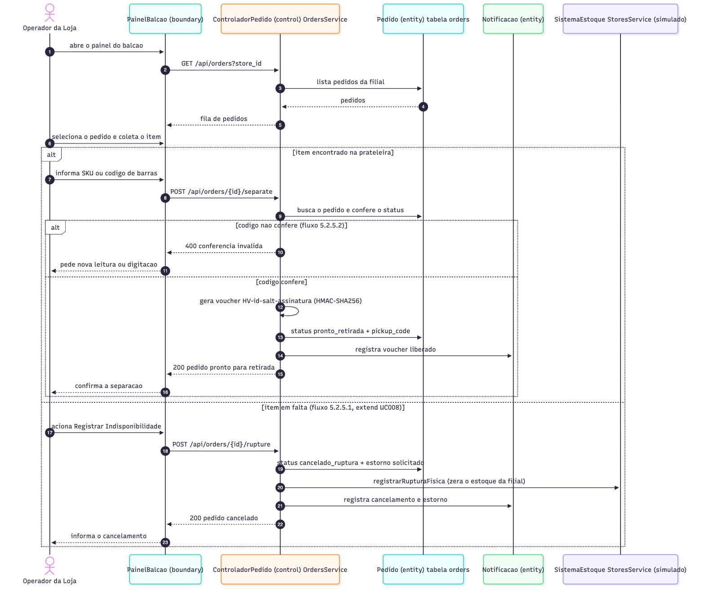
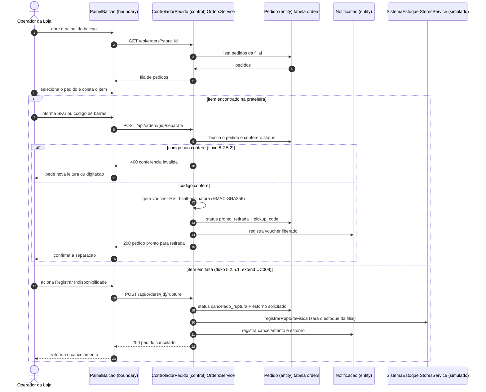
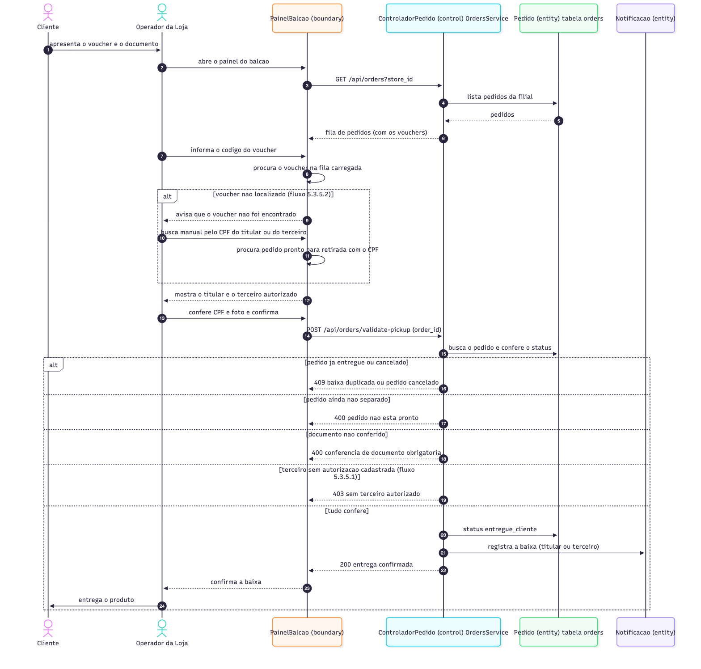
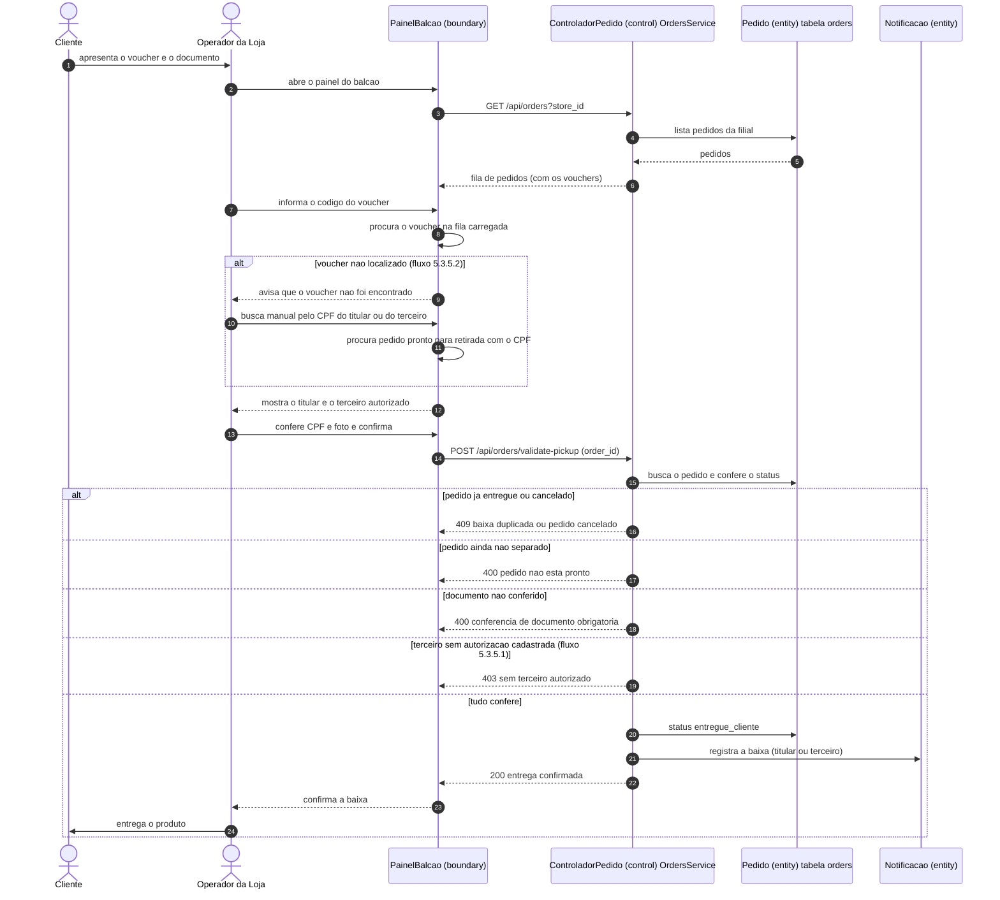

# Diagramas de sequência de UC005 e UC007 (S2-04)

> Gerado a partir do código da `main` em 12/11/2026 (backend NestJS + Supabase). É a versão em Mermaid, que o GitHub desenha sozinho; a imagem está em `sequencia-uc005.png` e `sequencia-uc007.png`. O cartão pede também o arquivo `.drawio`: para isso, no Draw.io use Organizar > Inserir > Avançado > Mermaid e cole o bloco abaixo. Falta a revisão da Júlia e do João.

Seguem o padrão BCE do diagrama do UC003 entregue na Sprint 1.

## UC005 Separar Pedido (com a extensão UC008 Registrar Ruptura)

## UC007 Validar Retirada

## Diferenças em relação ao texto dos casos de uso

| Caso de uso | No documento | No sistema hoje |
|---|---|---|
| UC005, passo 7 | "envia a notificação para o cliente" | a notificação é **gravada no banco**; não há e-mail |
| UC005, condição prévia | operador logado com perfil de retaguarda | **não há login** do operador (S3-14) |
| UC007, passo 2 | o operador escaneia o QR Code com leitor | o operador **digita ou cola** o código do voucher; não há leitura por câmera (S3-02) |
| UC007, fluxo 5.3.5.2 | busca por CPF e número do pedido | o painel procura pelo **CPF** do titular ou do terceiro entre os pedidos prontos da filial |
| UC007, requisito especial | modo offline | não existe (S3-01) |
